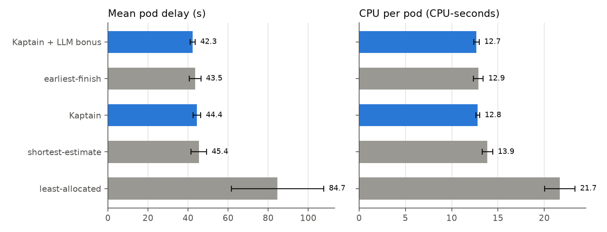
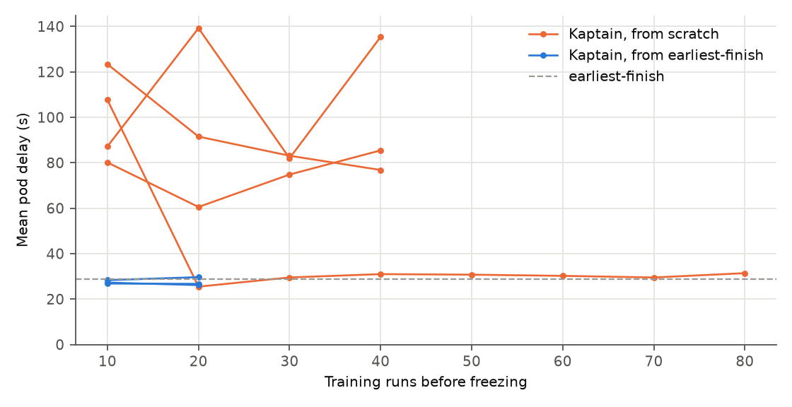

# Kaptain

Kaptain places Kubernetes pods on a cluster whose machines differ: fast VMs, small VMs, a
Raspberry Pi, a Jetson. For each kind of task and each node, it learns how long the task takes
there. A reinforcement-learning policy (PPO) then picks the node, and an LLM can score the
cluster's state to guide its training.

Research project for IFT-7026, Université Laval, by Léopold Chappuis and Alexandre Eberhardt.
Every number below was measured on our own K3s cluster, not in a simulator.

## Results

- **Knowing how long a task takes on each node gives most of the gain.** On the edge cluster,
  rules that use these runtime estimates halve the mean delay of a pod compared with
  least-allocated (43 to 45 s instead of 85 s), and use 36 to 41% less CPU per pod.
- **The learned policy does not beat these rules yet.** Trained from scratch, it is unstable:
  only 1 training in 4 got close to the rules (Figure 2). Started from the earliest-finish rule,
  it is stable but ends level with it.
- **The LLM has no measurable effect yet.** On the 4-worker cluster, Kaptain with the LLM's
  bonus does no better than with a random bonus of the same kind. On the edge cluster it has the
  lowest mean delay (42.3 s), but within the noise of earliest-finish (43.5 s).
- **On the 4-worker cluster, avoiding the Pi is almost all that matters.** Once pods stay off
  it, which VM they go to barely changes their delay, so there is little left to learn there.
  That is why we moved to the edge cluster: without the 8-vCPU VM, placement has to trade
  between slow nodes and busy ones.



**Figure 1. Edge cluster.** Mean delay of a pod (from its creation to its end) and the CPU time
it used, over 5 evaluation seeds. Kaptain starts from earliest-finish and is trained 3 times
independently, 10 runs each. Bars are 95% intervals, over the seeds, or over the trainings for
Kaptain. Campaign
[42422003977](https://github.com/leopoldch/kaptain/actions/runs/42422003977).



**Figure 2. 4-worker cluster: Kaptain along its training.** Each line is one training, frozen
every 10 training runs and replayed on two validation seeds. From scratch (orange), 1 training
in 4 reaches earliest-finish. Started from earliest-finish (blue), all 3 stay level with it.
Campaigns [40798185088](https://github.com/leopoldch/kaptain/actions/runs/40798185088),
[40903982901](https://github.com/leopoldch/kaptain/actions/runs/40903982901) and
[41251873008](https://github.com/leopoldch/kaptain/actions/runs/41251873008).

**4-worker cluster**, same workload, mean over the 5 evaluation seeds:

| Policy | Mean delay (s) | CPU per pod (CPU-s) |
|---|---:|---:|
| least-allocated | 40.1 | 10.2 |
| Kubernetes default scheduler | 38.1 | 10.0 |
| shortest-estimate | 27.9 | 8.4 |
| earliest-finish | 28.9 | 8.5 |
| Kaptain, from scratch (3 trainings × 40 runs) | 98.5 | 13.3 |
| Kaptain, from earliest-finish (3 × 20) | 29.1 | 8.8 |
| … + LLM bonus | 30.2 | 9.0 |
| … + random bonus | 29.9 | 9.0 |

The first five rows come from campaign 40903982901, the last three from 41251873008.

### Setup

| | 4-worker cluster | Edge cluster |
|---|---|---|
| Nodes | one 8-vCPU VM, two 1-vCPU VMs, Raspberry Pi 5 | the 4-vCPU master (a VPS), Jetson Orin Nano, two 1-vCPU VMs, Raspberry Pi 5 |
| Network | WireGuard VPN, K3s v1.31 | same |

- **Workload:** 60 `stress-ng` pods per run, one every 5 s, a third each CPU, memory and disk
  tasks, each with a CPU limit between 200 and 500 millicores.
- **Seeds:** a seed fixes the pods and their arrival times. Every policy runs the same 5
  evaluation seeds. The policies that learn first train on other seeds, then run frozen.
- **The rules:**
  - least-allocated: picks the node with the most unrequested CPU and memory.
  - shortest-estimate: picks the node where the task's estimated runtime is shortest.
  - earliest-finish: adds to that estimate the work already running on the node, shared over
    its cores.

## Reproduce with Vagrant

Vagrant builds a cluster of VMs on your machine and runs a whole campaign by itself. You need
[VirtualBox](https://www.virtualbox.org/) 7.1+ and
[Vagrant](https://developer.hashicorp.com/vagrant/install) 2.4.9+, about 12 GB of free RAM,
25 GB of disk, and Internet.

```bash
git clone https://github.com/leopoldch/kaptain.git
cd kaptain
cp .env.example .env    # then put your OpenAI API key in it: OPENAI_API_KEY=sk-...
vagrant up
```

**The OpenAI API key** is needed for the LLM policies (the names ending in `-llm` or
`-llm-ef`): `vagrant up` checks it with OpenAI before starting, and stops if it is refused.
Without a `.env`, these policies are skipped and the summary says so; the other policies run as
usual. Each LLM policy makes about 1,800 calls per experiment, so use a dedicated key with
prepaid credits. The key is kept in a Kubernetes secret inside the VMs, not in `results/`.

`vagrant up` creates a master and four workers, installs K3s, builds and deploys Kaptain, checks
it with a short smoke test, then starts the campaign in the background. The results land in
`results/<date>/campaign/`: one folder per run, `summary.md` with the tables, and `plots/`.

**First try:** the default campaign takes a day or more. For a run of under an hour, set this
in `vagrant.yaml` before `vagrant up`:

```yaml
campaign:
  experiments: even-5s
  strategies: earliest-finish least-allocated
  seeds: 7
  train_runs: 2
  replicates: 1
  validate_every: 0
```

```bash
vagrant ssh master -c 'journalctl -fu kaptain-campaign'      # follow the campaign
vagrant provision master --provision-with experiments        # run it again
vagrant provision master --provision-with setup,experiments  # again, on a new commit
vagrant destroy -f                                           # delete everything
```

- **Nodes:** their number, cores and speed are in `vagrant.yaml`. `cpu_cap` slows a node down.
- **Code:** the VMs run the last commit, not your uncommitted changes.
- **What it reproduces:** the procedure, not our numbers. The VMs share one machine's CPU and
  disk, and the Pi is only imitated with a CPU cap: it is not slow on disk, as the real one is.
  Compare the policies with each other, not with the tables above.
- **Tested on:** Linux amd64, macOS and Windows.
- **Windows:** disable Hyper-V (`bcdedit /set hypervisorlaunchtype off` as administrator, then
  restart). Under it, the VMs have no AVX, which `stress-ng` needs. Docker Desktop on WSL2 and
  WSL stop working until you set it back to `auto` and restart.
- **`<inaccessible>` error:** remove the stale VM with `VBoxManage unregistervm <uuid>`.

### Our numbers, from our raw data

Every campaign on the real cluster keeps its raw runs as a GitHub artifact. To get the tables
above from them, with their intervals:

```bash
gh run download 42422003977 -D results/42422003977
python3 workloads/ktable.py results/42422003977
```

On the real cluster, campaigns start from **Actions → Run campaign**.

## More

- [DESIGN.md](DESIGN.md): how the scheduler plugin and the decider work, every policy, the
  logs, and how to run them on a local `kind` cluster.
- [workloads/README.md](workloads/README.md): the experiments and the tools that run them.
